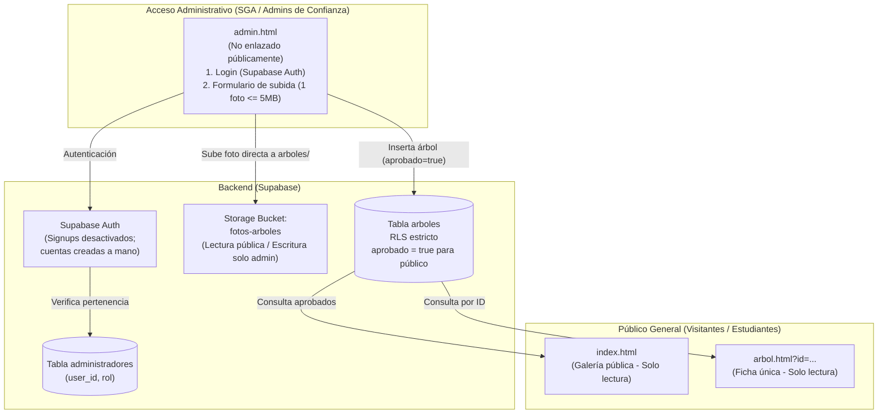
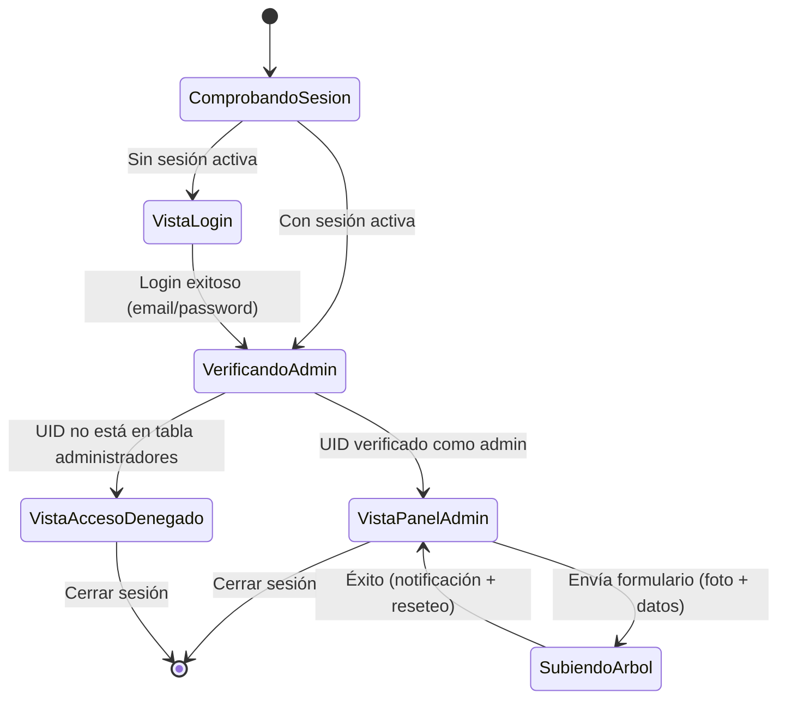

# Arquitectura del Sistema: Keiser Trees

**Proyecto:** Guía de árboles del campus de Keiser University Latin American Campus (San Marcos, Carazo, Nicaragua)  
**Organización:** SGA 2025-2026  
**Rol responsable:** `arquitecto`  
**Estado:** Actualizado — Modo Administrativo Restringido (Sin envíos públicos)  

---

## 1. Visión General y Modelo de Acceso

El catálogo de árboles de Keiser University se concibe como un sitio público dinámico de consulta botánica y ambiental, desacoplado de la edición manual de código HTML.

### Principio de Diseño
> **Cero edición de HTML/CSS para agregar contenido.**  
> Toda la información de los árboles proviene de la base de datos de **Supabase**. Las vistas públicas (`index.html` y `arbol.html?id=...`) son plantillas de solo lectura. La creación y actualización de árboles se realiza exclusivamente por usuarios con rol de **administrador** desde una página privada de gestión (`admin.html`).



### Reglas Clave de Acceso
1. **Sin autoregistro ni envíos públicos:** En la configuración de Supabase Auth, la opción *"Enable email signup"* permanece **desactivada**. Solo el superadministrador crea cuentas desde el panel de Supabase (*Authentication > Users*).
2. **El público general solo lee:** El rol anónimo (`anon`) tiene acceso únicamente a sentencias `SELECT` de registros aprobados.
3. **Las subidas e inserciones son exclusivas de administradores verificados.**

---

## 2. Estructura de Archivos y Carpetas

Para eliminar la duplicación de estilos y desacoplar la lógica en módulos JavaScript nativos (ES Modules), se establece la siguiente estructura:

```text
Keiser Trees/
│
├── .agent/                       # Skills y lineamientos de agentes
│   └── skills/
├── data/
│   ├── arboles.json              # Datos canónicos y semilla (datos-arboles)
│   ├── FALTANTES.md              # Lista de datos y fotos pendientes del campus
│   └── schema.sql                # DDL, tablas, índices y políticas RLS (seguridad-moderacion)
│
├── css/
│   ├── base.css                  # Variables compartidas (--bg, --accent, --gold),
│   │                             # tipografía Poppins, reset, hero-header, botones y footer.
│   ├── galeria.css               # Cuadrícula y tarjetas de index.html
│   ├── ficha.css                 # Maquetación detallada de arbol.html
│   └── admin.css                 # Estilos del login y panel de subida de admin.html
│
├── js/
│   ├── config.js                 # Cliente Supabase (URL y Anon Key públicas parametrizadas)
│   ├── data.js                   # Consultas públicas (getArboles(), getArbolById(id))
│   ├── render.js                 # Construcción segura de nodos DOM (textContent, sin XSS)
│   ├── admin.js                  # Lógica de admin.html: login, comprobación de rol, subida y cierre de sesión
│   ├── app-galeria.js            # Controlador de index.html
│   └── app-ficha.js              # Controlador de arbol.html
│
├── images/
│   ├── keiserbanner.jpg          # Banner del campus
│   └── arboles/                  # Imágenes locales de los árboles del campus
│
├── index.html                    # Galería pública (solo lectura, sin enlaces a admin)
├── arbol.html                    # Ficha dinámica por query param (?id=...) (solo lectura)
├── admin.html                    # NUEVO: Portal privado para administradores (login + alta de árboles)
│
├── AGENTS.md                     # Reglas de coordinación del equipo
├── ARCHITECTURE.md               # Este documento
├── DESIGN.md                     # Sistema de diseño e interfaces (disenador-ux-ui)
├── HANDOFF.md                    # Matriz de tareas pendientes entre agentes
├── SECURITY.md                   # Políticas de RLS, Storage y seguridad (seguridad-moderacion)
├── QA_REPORT.md                  # Reportes de calidad y pruebas (qa-pruebas)
└── A11Y_SEO_REPORT.md            # Reportes de accesibilidad y SEO (accesibilidad-seo)
```

### Unificación de Estilos (`css/base.css`)
- [styles.css](file:///c:/Users/jala1/OneDrive/Desktop/KU%20Trees%20Web%20Page/Keiser%20Trees/styles.css) y [arboles.css](file:///c:/Users/jala1/OneDrive/Desktop/KU%20Trees%20Web%20Page/Keiser%20Trees/arboles.css) comparten paleta, tipografía, cabeceras y pie de página.
- Se concentran estos estilos globales en `css/base.css`.
- Las páginas públicas cargan `base.css` + su hoja específica (`galeria.css` o `ficha.css`).
- `admin.html` reutiliza `base.css` + `admin.css`.

---

## 3. Esquema de Base de Datos y Storage en Supabase

El proyecto en Supabase tiene activadas las restricciones:
- *"Automatically expose new tables" está desactivado.*
- *"Enable automatic RLS" está activado.*

Por ende, toda tabla requiere `GRANT` y políticas explícitas.

### 3.1. Identificación de Administradores: Tabla `administradores`

Para gestionar quiénes pueden subir contenido sin otorgar accesos directos al panel de Supabase a todos los colaboradores, se crea la tabla de control `public.administradores`:

```sql
CREATE TABLE public.administradores (
    user_id UUID PRIMARY KEY REFERENCES auth.users(id) ON DELETE CASCADE,
    email TEXT NOT NULL,
    nombre TEXT,
    rol TEXT NOT NULL DEFAULT 'admin' CHECK (rol IN ('admin', 'editor')),
    created_at TIMESTAMPTZ NOT NULL DEFAULT now()
);

-- Permisos y RLS
GRANT SELECT ON public.administradores TO authenticated;
ALTER TABLE public.administradores ENABLE ROW LEVEL SECURITY;

-- Un usuario autenticado solo puede verificar si su propio uid está en la lista de administradores
CREATE POLICY "Usuario consulta su propio estado de admin"
ON public.administradores
FOR SELECT
TO authenticated
USING (auth.uid() = user_id);
```

> **Procedimiento de alta de administradores:**  
> 1. El dueño del proyecto crea el usuario en *Supabase Dashboard > Authentication > Users* (con correo y contraseña).  
> 2. Copia el `User UID` generado y lo inserta en la tabla `public.administradores` asignándole su rol.

---

### 3.2. Tabla `arboles` y Decisión sobre la Columna `aprobado`

> [!NOTE]
> **Decisión arquitectónica sobre la columna `aprobado`:**  
> **Se conserva la columna `aprobado` (booleano).**  
> *Motivo:* Proporciona un mecanismo de **ocultamiento controlado ("soft-hide" o borrador)** sin requerir la eliminación física de registros ni la pérdida de fotos en Storage. Si un ejemplar sufre daños, entra en cuarentena fitosanitaria o se requiere editar su información antes de publicarlo, el administrador simplemente marca `aprobado = false` y el árbol deja de mostrarse en la galería pública inmediatamente.

```sql
CREATE TABLE public.arboles (
    id UUID PRIMARY KEY DEFAULT gen_random_uuid(),
    slug TEXT UNIQUE,                                   -- Identificador legible (ej. 'teca', 'madrono')
    nombre_comun TEXT NOT NULL,                         -- Nombre popular
    nombre_cientifico TEXT NOT NULL,                    -- Nombre botánico
    descripcion TEXT NOT NULL,                          -- Descripción general
    beneficios TEXT,                                    -- Beneficios ecológicos y medicinales
    ubicacion TEXT NOT NULL,                            -- Ubicación en el campus
    anio_plantacion INTEGER,                            -- Año aproximado (nullable)
    altura_m NUMERIC(4, 1),                             -- Altura en metros (nullable)
    estado_salud TEXT DEFAULT 'Bueno',                  -- 'Excelente', 'Bueno', 'Regular'
    imagen_url TEXT NOT NULL,                           -- URL pública en Supabase Storage
    origen TEXT NOT NULL DEFAULT 'campus' CHECK (origen IN ('campus', 'admin')),
    aprobado BOOLEAN NOT NULL DEFAULT true,             -- Control de visibilidad pública
    created_by UUID REFERENCES auth.users(id),          -- Administrador que registró el árbol
    created_at TIMESTAMPTZ NOT NULL DEFAULT now()
);

-- Índices
CREATE INDEX idx_arboles_aprobado ON public.arboles (aprobado);
CREATE INDEX idx_arboles_created_at ON public.arboles (created_at DESC);

-- Permisos de PostgREST
GRANT USAGE ON SCHEMA public TO anon, authenticated;
GRANT SELECT ON public.arboles TO anon;
GRANT SELECT, INSERT, UPDATE, DELETE ON public.arboles TO authenticated;

-- Activar RLS
ALTER TABLE public.arboles ENABLE ROW LEVEL SECURITY;

-- 1. Lectura pública: Visitantes anónimos solo leen árboles con aprobado = true
CREATE POLICY "Público solo lee árboles aprobados"
ON public.arboles
FOR SELECT
TO anon
USING (aprobado = true);

-- 2. Lectura administrativa: Administradores pueden ver todos (aprobados y ocultos)
CREATE POLICY "Admins leen todos los árboles"
ON public.arboles
FOR SELECT
TO authenticated
USING (
    EXISTS (
        SELECT 1 FROM public.administradores 
        WHERE administradores.user_id = auth.uid()
    )
);

-- 3. Inserción administrativa: Solo usuarios en la tabla administradores
CREATE POLICY "Solo administradores pueden crear árboles"
ON public.arboles
FOR INSERT
TO authenticated
WITH CHECK (
    EXISTS (
        SELECT 1 FROM public.administradores 
        WHERE administradores.user_id = auth.uid()
    )
);

-- 4. Modificación administrativa: Solo administradores
CREATE POLICY "Solo administradores pueden modificar árboles"
ON public.arboles
FOR UPDATE
TO authenticated
USING (
    EXISTS (
        SELECT 1 FROM public.administradores 
        WHERE administradores.user_id = auth.uid()
    )
)
WITH CHECK (
    EXISTS (
        SELECT 1 FROM public.administradores 
        WHERE administradores.user_id = auth.uid()
    )
);

-- 5. Eliminación administrativa: Solo administradores
CREATE POLICY "Solo administradores pueden eliminar árboles"
ON public.arboles
FOR DELETE
TO authenticated
USING (
    EXISTS (
        SELECT 1 FROM public.administradores 
        WHERE administradores.user_id = auth.uid()
    )
);
```

---

### 3.3. Bucket de Storage (`fotos-arboles`)

Se elimina por completo el concepto de subida anónima y la carpeta `pendientes/`.

- **Nombre del bucket:** `fotos-arboles`
- **Visibilidad:** Público (para servir las imágenes en la galería sin firmas temporales).
- **Estructura de carpetas:**
  - `arboles/`: Fotos oficiales subidas por administradores (`arboles/<slug-o-uuid>.<ext>`).
- **Políticas de Storage en `storage.objects`:**
  - **Lectura:** Pública para cualquier visitante (`SELECT`).
  - **Escritura (`INSERT`, `UPDATE`, `DELETE`):** Restringida estrictamente a usuarios autenticados presentes en `public.administradores`.
  - **Restricciones de archivo (aplicadas en cliente y en RLS de Storage):**
    - Tamaño máximo: $\le 5\text{ MB}$ (5,242,880 bytes).
    - Formatos permitidos: `image/jpeg`, `image/png`, `image/webp`.

---

## 4. Definición de `admin.html`

`admin.html` es una página privada y aislada para la gestión del catálogo.

> [!WARNING]
> **Aislamiento de la página de administración:**  
> - `admin.html` **NO debe incluirse en ningún menú ni enlace público** de `index.html` ni de `arbol.html`.  
> - Debe incluir `<meta name="robots" content="noindex, nofollow">` en su `<head>` para evitar indexación en motores de búsqueda.

### Flujo de Estados en `admin.html` (`js/admin.js`):



### Componentes de la Interfaz:
1. **Vista 1 — Inicio de Sesión:**
   - Formulario limpio con campos: Correo electrónico y Contraseña.
   - Botón *"Iniciar sesión"*.
   - Mensajes de error claros ante credenciales incorrectas.
2. **Vista 2 — Panel de Alta de Árboles (Visible tras login validado):**
   - Barra superior con correo del usuario activo y botón *"Cerrar sesión"*.
   - **Formulario de registro:**
     - Nombre común y Nombre científico (*obligatorios*).
     - Descripción general (*obligatorio*).
     - Beneficios ecológicos y medicinales.
     - Ubicación dentro del campus (*obligatorio*).
     - Año de plantación aproximado y Altura estimada en metros.
     - Estado de salud (selector: *Excelente, Bueno, Regular, En recuperación*).
     - **Campo de imagen único:** `<input type="file" accept="image/jpeg,image/png,image/webp">` (sin `multiple`, límite de 5 MB, con vista previa inmediata).
     - Casilla de verificación: *"Publicar de inmediato en la galería"* (determina `aprobado: true / false`).
   - Botón *"Guardar árbol"* con indicador visual de progreso y deshabilitado durante la subida.

---

## 5. Estrategia de Migración de los 11 Árboles del Campus

La migración preserva los datos históricos y soluciona las inconsistencias de nombres e imágenes detectadas en [index.html](file:///c:/Users/jala1\OneDrive\Desktop\KU Trees Web Page\Keiser Trees\index.html):

1. **Normalización (`datos-arboles`):**
   - Construye `data/arboles.json` con los 11 árboles bien clasificados, corrigiendo los enlaces y nombres científicos cruzados.
   - Genera `data/FALTANTES.md` detallando las 10 fotografías pendientes para que el equipo humano las tome y facilite.
2. **Carga en Supabase:**
   - Una vez disponibles las imágenes, se suben al bucket `fotos-arboles/arboles/`.
   - Se ejecuta el script de inserción (seed) asignando `origen: 'campus'` y `aprobado: true`.
3. **Consumo Dinámico (`fullstack`):**
   - `index.html` retira el contenido hardcodeado y se conecta mediante `data.js` a Supabase para pintar las tarjetas aprobadas.

---

## 6. Distribución de Responsabilidades por Agente

| Agente | Responsabilidad Principal | Archivos Asignados |
| :--- | :--- | :--- |
| **`arquitecto`** | Definir arquitectura general, esquema RLS, flujo admin y contratos de datos. | `ARCHITECTURE.md`, `HANDOFF.md` |
| **`datos-arboles`** | Consolidar los 11 árboles en `data/arboles.json`, verificar taxonomía botánica y listar imágenes faltantes en `data/FALTANTES.md`. | `data/arboles.json`, `data/FALTANTES.md` |
| **`disenador-ux-ui`** | Diseñar la galería pública, la ficha `arbol.html` y la interfaz de `admin.html` (login y formulario). Unificar CSS base sin duplicados. | `DESIGN.md`, `css/*.css`, `styles.css`, `arboles.css` |
| **`seguridad-moderacion`** | Escribir el DDL definitivo en `data/schema.sql` y las reglas en `SECURITY.md`: tabla `administradores`, bloqueo de inserciones anónimas y políticas de Storage. Auditar ausencia de claves secretas. | `SECURITY.md`, `data/schema.sql`, `.gitignore` |
| **`fullstack`** | Implementar `admin.html`, `arbol.html`, modularizar JS (`config.js`, `data.js`, `render.js`, `admin.js`) y conectar la galería con Supabase. | `*.html`, `js/*.js` |
| **`qa-pruebas`** | Auditar que `admin.html` no permita subidas sin auth, validar límites de archivo (5 MB, formatos), probar la visualización pública y el comportamiento de la bandera `aprobado`. | `QA_REPORT.md` (Solo reporte) |
| **`accesibilidad-seo`** | Garantizar WCAG AA en `admin.html` (labels, teclado, alertas) y asegurar que `admin.html` tenga `noindex, nofollow` mientras las páginas públicas conservan metadatos SEO. | `A11Y_SEO_REPORT.md` (Solo reporte) |

---
*Fin de ARCHITECTURE.md — Versión actualizada para administración restringida.*
