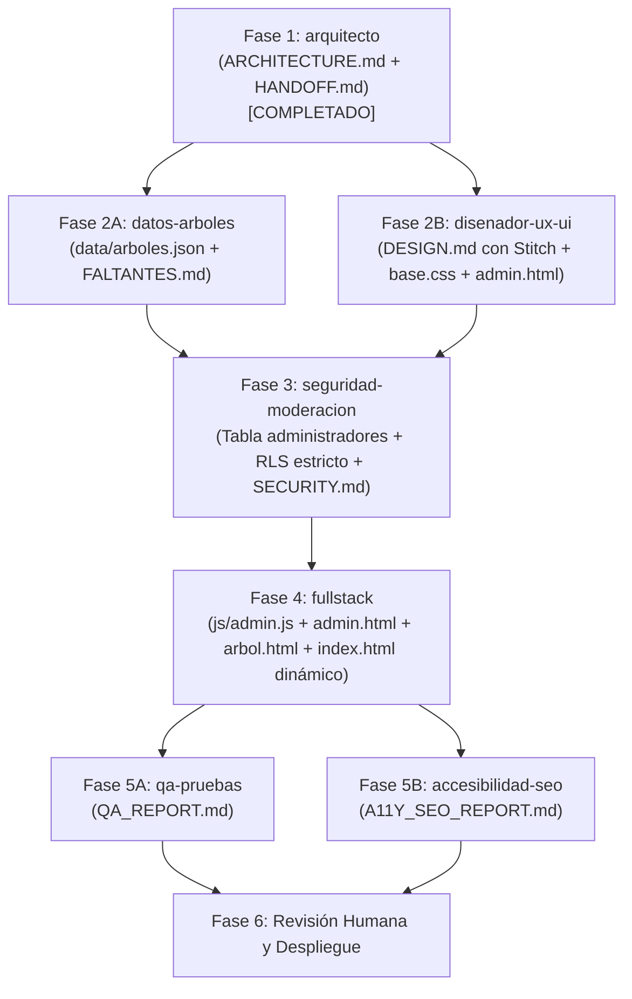

# HANDOFF.md — Registro de Tareas y Pasos entre Agentes

**Proyecto:** Keiser Trees  
**Última actualización:** Arquitectura actualizada para gestión restringida a administradores (`admin.html`)  
**Referencia obligatoria:** [ARCHITECTURE.md](file:///c:/Users/jala1/OneDrive/Desktop/KU%20Trees%20Web%20Page/Keiser%20Trees/ARCHITECTURE.md) y [AGENTS.md](file:///c:/Users/jala1/OneDrive/Desktop/KU%20Trees%20Web%20Page/Keiser%20Trees/AGENTS.md)

---

## Orden de Ejecución General



---

## 📋 Lista de Tareas Detallada por Agente

### 1. `datos-arboles` (Prioridad Alta)
- [x] **Crear `data/arboles.json`**:
  - Extraer los 11 árboles del catálogo de `index.html` y estructurarlos bajo el esquema oficial (`id`, `slug`, `nombre_comun`, `nombre_cientifico`, `descripcion`, `beneficios`, `ubicacion`, `anio_plantacion`, `altura_m`, `estado_salud`, `imagen_url`, `origen: "campus"`, `aprobado: true`).
  - Corregir los cruces de títulos e imágenes existentes en el HTML original.
  - Asegurar la taxonomía científica (*Género especie*).
- [x] **Crear `data/FALTANTES.md`**:
  - Detallar los 10 árboles del campus cuyas fotos faltan en la carpeta `images/` (para que el equipo del campus las recopile).
  - Marcar con `null` los datos botánicos de campo pendientes de medición física.

### 2. `disenador-ux-ui` (✅ COMPLETADO — 2026-10-26)

#### Entregables generados
- [x] `DESIGN.md` — Sistema de diseño completo (paleta, tipografía, espaciado, radios, sombras, transiciones, siluetas, componentes).
- [x] `css/base.css` — Variables globales, reset, hero, botones, badges de estado, alertas, placeholder de foto, footer.
- [x] `css/galeria.css` — Cuadrícula y tarjetas de `index.html`.
- [x] `css/ficha.css` — Layout y metadatos de `arbol.html`.
- [x] `css/admin.css` — Login, formulario de alta y barra superior de `admin.html`.
- [x] `styles.css` y `arboles.css` marcados como **DEPRECADOS** (mantener solo como referencia).

---

#### ⚙️ INSTRUCCIONES PARA `fullstack`

##### Cómo cargar los CSS en cada página

**`index.html` (galería):**
```html
<head>
  <!-- Fuentes (elegir Opción A o B de DESIGN.md §1) -->
  <link rel="preconnect" href="https://api.fontshare.com">
  <link rel="stylesheet"
    href="https://api.fontshare.com/v2/css?f[]=ranade@400,500,600,700&display=swap">
  <link rel="preconnect" href="https://fonts.googleapis.com">
  <link rel="preconnect" href="https://fonts.gstatic.com" crossorigin>
  <link rel="stylesheet"
    href="https://fonts.googleapis.com/css2?family=Inter:wght@400;500;600&display=swap">
  <!-- CSS del sitio -->
  <link rel="stylesheet" href="css/base.css">
  <link rel="stylesheet" href="css/galeria.css">
</head>
```

**`arbol.html` (ficha de árbol):**
```html
  <link rel="stylesheet" href="css/base.css">
  <link rel="stylesheet" href="css/ficha.css">
```

**`admin.html` (portal administrativo):**
```html
  <meta name="robots" content="noindex, nofollow"> <!-- OBLIGATORIO -->
  <link rel="stylesheet" href="css/base.css">
  <link rel="stylesheet" href="css/admin.css">
```

> **No cargar** `styles.css` ni `arboles.css` en páginas nuevas o migradas.

---

##### Estructura HTML de tarjeta de galería (`.card`)

```html
<!-- El <a> envuelve toda la tarjeta; el href va a arbol.html?id={id} -->
<a class="card" href="arbol.html?id={id}" aria-label="Ver ficha de {nombre_comun}">

  <!-- Imagen con object-fit: cover (corregido) -->
  <div class="card-media">
    <!-- Si imagen_url NO es null: -->
    

    <!-- Si imagen_url ES null: -->
    <div class="card-placeholder" aria-hidden="true">
      <span class="card-placeholder__icon">🌿</span>
      <span class="card-placeholder__text">Foto próximamente</span>
    </div>
  </div>

  <div class="card-body">
    <h3 class="card-title">{nombre_comun}</h3>
    <p class="sci-name">{nombre_cientifico}</p>

    <div class="card-meta">
      <span class="card-meta-item">
        📍 {ubicacion ?? "Por confirmar"}
      </span>
      <!-- Si tiene año_plantacion: -->
      <span class="card-meta-item">🗓 {anio_plantacion}</span>
    </div>

    <!-- Badge de estado de salud (si existe) -->
    <div class="card-estado">
      <!-- clase dinámica según estado_salud: badge-estado--{slug-del-estado} -->
      <!-- Slugs: excelente | bueno | regular | recuperacion | malo | seco -->
      <span class="badge-estado badge-estado--{slug}">{estado_salud ?? "Por confirmar"}</span>
    </div>
  </div>

  <div class="card-actions">
    <span class="btn btn-primary">Ver ficha →</span>
  </div>
</a>
```

**Slugs del badge según `estado_salud`:**
| Valor en BD | Clase CSS |
|---|---|
| `Excelente` | `badge-estado--excelente` |
| `Bueno` | `badge-estado--bueno` |
| `Regular` | `badge-estado--regular` |
| `En recuperación` | `badge-estado--recuperacion` |
| `Malo` | `badge-estado--malo` |
| `Seco` | `badge-estado--seco` |
| `null` | Mostrar texto "Por confirmar" sin badge |

---

##### Estructura HTML de ficha de árbol (`arbol.html`)

```html
<main class="container">
  <a class="ficha-back" href="index.html">← Volver al catálogo</a>

  <article class="ficha">
    <!-- Columna imagen (izquierda en desktop) -->
    <div class="ficha-media">
      <!-- Si imagen_url NO es null: -->
      

      <!-- Si imagen_url ES null: -->
      <div class="card-placeholder card-placeholder--ficha" aria-hidden="true">
        <span class="card-placeholder__icon">🌿</span>
        <span class="card-placeholder__text">Foto próximamente</span>
      </div>
    </div>

    <!-- Columna información (derecha en desktop) -->
    <div class="ficha-info">
      <h1>{nombre_comun}</h1>
      <p class="sci-name">{nombre_cientifico}</p>

      <!-- Caja de metadatos -->
      <dl class="ficha-meta">
        <div class="ficha-meta-item">
          <dt class="ficha-meta-label">Ubicación</dt>
          <dd class="ficha-meta-value {ubicacion ? '' : 'ficha-meta-value--null'}">
            {ubicacion ?? "Por confirmar"}
          </dd>
        </div>
        <div class="ficha-meta-item">
          <dt class="ficha-meta-label">Año de plantación</dt>
          <dd class="ficha-meta-value {anio_plantacion ? '' : 'ficha-meta-value--null'}">
            {anio_plantacion ?? "Por confirmar"}
          </dd>
        </div>
        <div class="ficha-meta-item">
          <dt class="ficha-meta-label">Altura estimada</dt>
          <dd class="ficha-meta-value {altura_m ? '' : 'ficha-meta-value--null'}">
            {altura_m ? altura_m + " m" : "Por confirmar"}
          </dd>
        </div>
        <div class="ficha-meta-item ficha-meta-item--estado">
          <dt class="ficha-meta-label">Estado de salud</dt>
          <dd class="ficha-meta-value">
            {estado_salud
              ? '<span class="badge-estado badge-estado--{slug}">{estado_salud}</span>'
              : '<span class="ficha-meta-value--null">Por confirmar</span>'
            }
          </dd>
        </div>
      </dl>

      <!-- Descripción -->
      <div class="ficha-section">
        <h3>Descripción</h3>
        <p>{descripcion}</p>
      </div>

      <!-- Beneficios (si existen) -->
      {beneficios && (
        <div class="ficha-section">
          <h3>Beneficios ecológicos</h3>
          <p>{beneficios}</p>
        </div>
      )}

      <div class="ficha-actions">
        <a class="btn btn-secondary" href="index.html">← Volver al catálogo</a>
      </div>
    </div>
  </article>
</main>
```

---

##### Estructura HTML de `admin.html`

```html
<!-- Vista A: Login (ocultar tras login exitoso, sin eliminar del DOM) -->
<div id="view-login" class="admin-main">
  <div class="admin-login-card">
    <h1>Administración</h1>
    <p class="login-subtitle">Acceso restringido al equipo SGA</p>

    <div id="login-error" class="alert alert-error" role="alert" hidden>
      <span class="alert-icon" aria-hidden="true">✗</span>
      <p class="alert-message"><!-- mensaje de error --></p>
    </div>

    <form id="login-form">
      <div class="form-group">
        <label class="form-label form-label--required" for="email">Correo electrónico</label>
        <input class="form-control" type="email" id="email" name="email" required
          autocomplete="email" placeholder="correo@keiseruniversity.edu">
      </div>
      <div class="form-group">
        <label class="form-label form-label--required" for="password">Contraseña</label>
        <input class="form-control" type="password" id="password" name="password" required
          autocomplete="current-password">
      </div>
      <div class="form-actions">
        <button class="btn btn-primary" type="submit">Iniciar sesión</button>
      </div>
    </form>
  </div>
</div>

<!-- Vista B: Panel de alta (oculto hasta login + verificación de admin) -->
<div id="view-panel" class="admin-main" hidden>
  <div class="admin-panel-card">
    <h2>Registrar árbol nuevo</h2>

    <div id="form-alert" role="alert" hidden></div> <!-- .alert + .alert-success/.alert-error -->

    <form id="upload-form">
      <!-- Nombre común -->
      <div class="form-group">
        <label class="form-label form-label--required" for="nombre_comun">Nombre común</label>
        <input class="form-control" type="text" id="nombre_comun" name="nombre_comun" required>
        <p class="form-error" id="err-nombre_comun" hidden>Este campo es obligatorio.</p>
      </div>

      <!-- Nombre científico -->
      <div class="form-group">
        <label class="form-label form-label--required" for="nombre_cientifico">Nombre científico</label>
        <input class="form-control" type="text" id="nombre_cientifico" name="nombre_cientifico" required>
      </div>

      <!-- Descripción -->
      <div class="form-group">
        <label class="form-label form-label--required" for="descripcion">Descripción general</label>
        <textarea class="form-control" id="descripcion" name="descripcion" rows="4" required></textarea>
      </div>

      <!-- Beneficios -->
      <div class="form-group">
        <label class="form-label" for="beneficios">Beneficios ecológicos y medicinales</label>
        <textarea class="form-control" id="beneficios" name="beneficios" rows="3"></textarea>
      </div>

      <!-- Ubicación -->
      <div class="form-group">
        <label class="form-label form-label--required" for="ubicacion">Ubicación en el campus</label>
        <input class="form-control" type="text" id="ubicacion" name="ubicacion" required>
      </div>

      <!-- Año -->
      <div class="form-group">
        <label class="form-label" for="anio_plantacion">Año de plantación (aprox.)</label>
        <input class="form-control" type="number" id="anio_plantacion" name="anio_plantacion"
          min="1900" max="2099">
      </div>

      <!-- Altura -->
      <div class="form-group">
        <label class="form-label" for="altura_m">Altura estimada (metros)</label>
        <input class="form-control" type="number" id="altura_m" name="altura_m"
          min="0" step="0.1">
      </div>

      <!-- Estado de salud — OBLIGATORIO usar <select>, no texto libre -->
      <div class="form-group">
        <label class="form-label" for="estado_salud">Estado de salud</label>
        <select class="form-control" id="estado_salud" name="estado_salud">
          <option value="">-- Sin especificar --</option>
          <option value="Excelente">Excelente</option>
          <option value="Bueno">Bueno</option>
          <option value="Regular">Regular</option>
          <option value="En recuperación">En recuperación</option>
          <option value="Malo">Malo</option>
          <option value="Seco">Seco</option>
        </select>
      </div>

      <!-- Foto (campo opcional, 1 sola foto) -->
      <div class="form-group">
        <label class="form-label" for="foto">Fotografía del árbol</label>
        <div class="file-upload-area" role="button" tabindex="0"
          aria-label="Haz clic para seleccionar una foto">
          <input type="file" id="foto" name="foto"
            accept="image/jpeg,image/png,image/webp">
          <div class="file-upload-icon" aria-hidden="true">📷</div>
          <p class="file-upload-text">
            <strong>Selecciona una foto</strong> o arrástrala aquí
          </p>
          <p class="file-upload-hint">JPG, PNG o WebP · Máximo 5 MB · Una sola foto</p>
        </div>
        <p class="form-error" id="err-foto" hidden></p>
        <div class="file-preview" id="foto-preview">
          
        </div>
      </div>

      <!-- Publicar de inmediato -->
      <div class="form-checkbox-group">
        <input class="form-checkbox" type="checkbox" id="publicar" name="publicar" checked>
        <label class="form-checkbox-label" for="publicar">
          Publicar de inmediato en la galería (<code>aprobado = true</code>)
        </label>
      </div>

      <!-- Barra de progreso -->
      <div class="upload-progress" id="upload-progress">
        <div class="upload-progress__bar-track">
          <div class="upload-progress__bar-fill" id="upload-bar"></div>
        </div>
        <p class="upload-progress__label" id="upload-label">Subiendo...</p>
      </div>

      <!-- Acciones — el botón se deshabilita durante la subida -->
      <div class="form-actions">
        <button class="btn btn-primary" type="submit" id="btn-guardar">
          Guardar árbol
        </button>
      </div>
    </form>
  </div>
</div>

<!-- Vista C: Acceso denegado -->
<div id="view-denied" class="admin-main" hidden>
  <div class="admin-denied">
    <h2>Acceso denegado</h2>
    <p>Tu cuenta no tiene permisos de administración. Contacta al responsable del SGA.</p>
    <button class="btn btn-outline" id="btn-cerrar-sesion-denied">Cerrar sesión</button>
  </div>
</div>
```

> **Nota importante para `fullstack`:** Para cambiar entre vistas, usa `hidden` attribute (no `display: none` en JS).  
> Para verificar rol admin, usar `supabase.rpc('is_admin')` — **no** consultar `supabase.from('admins')` directamente (tabla con REVOKE ALL).

---

##### Estructura del `<body>` de `admin.html`

```html
<body class="admin-body">
  <!-- Barra superior (visible solo post-login) -->
  <header class="admin-topbar" id="admin-topbar" hidden>
    <a class="admin-topbar__brand" href="#">🌿 Keiser Trees — Admin</a>
    <span class="admin-topbar__user" id="admin-email"></span>
    <button class="btn btn-outline" id="btn-cerrar-sesion">Cerrar sesión</button>
  </header>

  <!-- Vistas (A, B y C arriba) -->
  ...
</body>
```

---

##### Notas sobre siluetas decorativas

El fullstack puede insertar SVGs decorativos dentro de `.hero-header` y `.colorful-footer`:

```html
<svg class="tree-silhouette" aria-hidden="true" focusable="false"
  width="120" height="160" viewBox="0 0 120 160">
  <!-- SVG de silueta de árbol -->
</svg>
```

Las clases opcionales `.tree-silhouette--teca`, `--palmera`, `--pino`, `--malinche` permiten distinguir estilos por página si se desea.


### 3. `seguridad-moderacion` (Completado)
- [x] **Esquema SQL y RLS en `supabase/schema.sql` y `SECURITY.md`**:
  - Definida la tabla `public.admins (user_id UUID PRIMARY KEY REFERENCES auth.users(id) ON DELETE CASCADE)`.
  - Definida la función `public.is_admin()` tipo `SECURITY DEFINER` con `search_path = public, pg_temp`.
  - Concedido a `anon` únicamente permiso `SELECT` sobre `public.arboles`.
  - Concedido a `authenticated` permisos sujetos a RLS en `public.arboles`.
  - Revocados todos los accesos en `public.admins` para roles públicos (`REVOKE ALL FROM anon, authenticated, public`).
  - Configurado RLS en `arboles`: público lee si `aprobado = true`, administradores pueden leer todo y son los únicos con permisos de `INSERT`, `UPDATE` y `DELETE`.
  - Configurado bucket `fotos-arboles`: lectura pública, subida y gestión restringidas a administradores verificados vía `is_admin()`.
  - Añadido bloque de verificación automática e idempotencia completa en `supabase/schema.sql`.
- [x] **Configuración de Autenticación y Auditoría**:
  - Documentada en `SECURITY.md` la desactivación obligatoria de autoregistro (*Enable email signup: false*).
  - Documentados los pasos manuales para creación de administradores en Supabase Auth y alta de UID en `public.admins`.
  - Creado `.gitignore` protegiendo `.env*`, dependencias y archivos sensibles del sistema.

### 4. `fullstack` (Prioridad Media — tras datos, diseño y seguridad)
- [ ] **Implementación de `admin.html` y `js/admin.js`**:
  - Crear `admin.html` con `<meta name="robots" content="noindex, nofollow">` (**no enlazarlo en el menú ni pie de página público**).
  - Implementar flujo de inicio y cierre de sesión con Supabase Auth (`supabase.auth.signInWithPassword(...)`).
  - **Verificación de rol admin (IMPORTANTE para fullstack):**  
    Para verificar si el usuario tiene permisos administrativos tras hacer login, llamar a la función RPC:  
    `const { data: isAdmin, error } = await supabase.rpc('is_admin');`  
    *Nota:* No intentar consultar directamente `supabase.from('admins')` porque dicha tabla tiene `REVOKE ALL` para roles web por seguridad.
  - Implementar el formulario de subida:
    - Validación en cliente de 1 sola foto, $\le 5\text{ MB}$, formatos `image/jpeg`, `image/png`, `image/webp`.
    - Vista previa reactiva de la fotografía seleccionada.
    - Subida al bucket `fotos-arboles/arboles/` e inserción en la tabla `arboles` con `aprobado: true` (o valor del checkbox).
- [ ] **Implementación Pública (`index.html` y `arbol.html`)**:
  - `index.html`: Carga dinámica de árboles aprobados vía `js/data.js` y renderizado seguro con `js/render.js` (uso estricto de `textContent`).
  - `arbol.html`: Ficha única que consulta el árbol por parámetro `?id=...` y muestra estado de error amigable si el árbol no existe o está oculto.
  - Importar la tipografía Poppins en todas las páginas.

### 5. `qa-pruebas` (Prioridad Normal — post-implementación)
- [ ] **Auditoría de Funcionalidad y Seguridad en `QA_REPORT.md`**:
  - Probar que `admin.html` no permite visualizar el formulario ni subir contenido sin iniciar sesión con una cuenta autorizada.
  - Intentar realizar una inserción directa desde la consola del navegador como usuario anónimo (debe ser rechazada por RLS).
  - Probar la subida de un árbol desde `admin.html`:
    - Validar rechazo de fotos mayores a 5 MB o formatos no permitidos.
    - Verificar que al marcar `aprobado = true`, el árbol aparece inmediatamente en `index.html`.
    - Verificar que al cambiar un árbol a `aprobado = false`, desaparece de `index.html` pero se mantiene en la base de datos sin errores.
  - Validar navegación responsiva y ausencia de errores de consola.

### 6. `accesibilidad-seo` (Prioridad Normal — post-implementación)
- [ ] **Auditoría en `A11Y_SEO_REPORT.md`**:
  - Verificar que `admin.html` cuenta con directivas `noindex, nofollow` para evitar indexación en motores de búsqueda.
  - Evaluar accesibilidad del formulario de administración: `<label>` vinculados, navegación por teclado y contraste cromático.
  - Verificar metadatos SEO y Open Graph dinámicos en las páginas públicas (`index.html` y `arbol.html`).

### 7. Revisión Humana y Administración SGA
- [ ] Crear la cuenta de administrador en *Supabase Dashboard > Authentication > Users*.
- [ ] Ejecutar el script `schema.sql` en Supabase y agregar el UID del administrador a `public.administradores`.
- [ ] Desactivar el registro público (*Disable email signup*) en la configuración de Auth de Supabase.
- [ ] Proporcionar las imágenes reales faltantes del campus identificadas en `data/FALTANTES.md`.
- [ ] Ingresar las credenciales públicas del proyecto (URL y Anon Key) en `js/config.js`.

---
*Fin de HANDOFF.md — Guía de coordinación oficial.*
