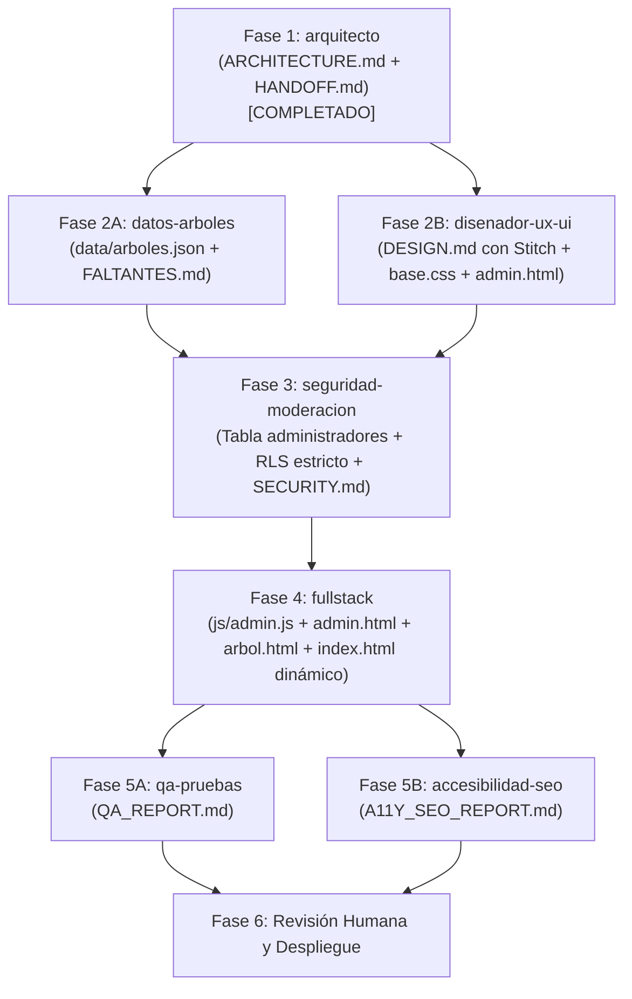

# HANDOFF.md — Registro de Tareas y Pasos entre Agentes

**Proyecto:** Keiser Trees  
**Última actualización:** Arquitectura actualizada para gestión restringida a administradores (`admin.html`)  
**Referencia obligatoria:** [ARCHITECTURE.md](file:///c:/Users/jala1/OneDrive/Desktop/KU%20Trees%20Web%20Page/Keiser%20Trees/ARCHITECTURE.md) y [AGENTS.md](file:///c:/Users/jala1/OneDrive/Desktop/KU%20Trees%20Web%20Page/Keiser%20Trees/AGENTS.md)

---

## Orden de Ejecución General

---

## 📋 Lista de Tareas Detallada por Agente

### 1. `datos-arboles` (Prioridad Alta)
- [x] **Crear `data/arboles.json`**:
  - Extraer los 11 árboles del catálogo de `index.html` y estructurarlos bajo el esquema oficial (`id`, `slug`, `nombre_comun`, `nombre_cientifico`, `descripcion`, `beneficios`, `ubicacion`, `anio_plantacion`, `altura_m`, `estado_salud`, `imagen_url`, `origen: "campus"`, `aprobado: true`).
  - Corregir los cruces de títulos e imágenes existentes en el HTML original.
  - Asegurar la taxonomía científica (*Género especie*).
- [x] **Crear `data/FALTANTES.md`**:
  - Detallar los 10 árboles del campus cuyas fotos faltan en la carpeta `images/` (para que el equipo del campus las recopile).
  - Marcar con `null` los datos botánicos de campo pendientes de medición física.

### 2. `disenador-ux-ui` (Prioridad Alta — en paralelo con `datos-arboles`)
- [ ] **Diseño en Google Stitch (vía MCP)**:
  - Diseñar pantallas y componentes:
    1. **Galería pública (`index.html`):** Cuadrícula limpia y adaptable, **sin botones ni enlaces públicos de envío**.
    2. **Ficha de árbol (`arbol.html`):** Detalle responsivo con corrección de `object-fit: cover`.
    3. **Portal administrativo (`admin.html`):**
       - Estado A: Formulario de inicio de sesión sobrio y seguro (email y password).
       - Estado B: Formulario de carga de árbol (campos botánicos, selector de archivo único con vista previa, checkbox "Publicar de inmediato", botón de guardado con estado de carga).
  - Documentar el sistema visual en `DESIGN.md`.
- [ ] **Unificación de CSS**:
  - Consolidar variables, hero, botones y footer en `css/base.css`.
  - Crear estilos específicos: `css/galeria.css`, `css/ficha.css` y `css/admin.css`.

### 3. `seguridad-moderacion` (Completado)
- [x] **Esquema SQL y RLS en `supabase/schema.sql` y `SECURITY.md`**:
  - Definida la tabla `public.admins (user_id UUID PRIMARY KEY REFERENCES auth.users(id) ON DELETE CASCADE)`.
  - Definida la función `public.is_admin()` tipo `SECURITY DEFINER` con `search_path = public, pg_temp`.
  - Concedido a `anon` únicamente permiso `SELECT` sobre `public.arboles`.
  - Concedido a `authenticated` permisos sujetos a RLS en `public.arboles`.
  - Revocados todos los accesos en `public.admins` para roles públicos (`REVOKE ALL FROM anon, authenticated, public`).
  - Configurado RLS en `arboles`: público lee si `aprobado = true`, administradores pueden leer todo y son los únicos con permisos de `INSERT`, `UPDATE` y `DELETE`.
  - Configurado bucket `fotos-arboles`: lectura pública, subida y gestión restringidas a administradores verificados vía `is_admin()`.
  - Añadido bloque de verificación automática e idempotencia completa en `supabase/schema.sql`.
- [x] **Configuración de Autenticación y Auditoría**:
  - Documentada en `SECURITY.md` la desactivación obligatoria de autoregistro (*Enable email signup: false*).
  - Documentados los pasos manuales para creación de administradores en Supabase Auth y alta de UID en `public.admins`.
  - Creado `.gitignore` protegiendo `.env*`, dependencias y archivos sensibles del sistema.

### 4. `fullstack` (Prioridad Media — tras datos, diseño y seguridad)
- [ ] **Implementación de `admin.html` y `js/admin.js`**:
  - Crear `admin.html` con `<meta name="robots" content="noindex, nofollow">` (**no enlazarlo en el menú ni pie de página público**).
  - Implementar flujo de inicio y cierre de sesión con Supabase Auth (`supabase.auth.signInWithPassword(...)`).
  - **Verificación de rol admin (IMPORTANTE para fullstack):**  
    Para verificar si el usuario tiene permisos administrativos tras hacer login, llamar a la función RPC:  
    `const { data: isAdmin, error } = await supabase.rpc('is_admin');`  
    *Nota:* No intentar consultar directamente `supabase.from('admins')` porque dicha tabla tiene `REVOKE ALL` para roles web por seguridad.
  - Implementar el formulario de subida:
    - Validación en cliente de 1 sola foto, $\le 5\text{ MB}$, formatos `image/jpeg`, `image/png`, `image/webp`.
    - Vista previa reactiva de la fotografía seleccionada.
    - Subida al bucket `fotos-arboles/arboles/` e inserción en la tabla `arboles` con `aprobado: true` (o valor del checkbox).
- [ ] **Implementación Pública (`index.html` y `arbol.html`)**:
  - `index.html`: Carga dinámica de árboles aprobados vía `js/data.js` y renderizado seguro con `js/render.js` (uso estricto de `textContent`).
  - `arbol.html`: Ficha única que consulta el árbol por parámetro `?id=...` y muestra estado de error amigable si el árbol no existe o está oculto.
  - Importar la tipografía Poppins en todas las páginas.

### 5. `qa-pruebas` (Prioridad Normal — post-implementación)
- [ ] **Auditoría de Funcionalidad y Seguridad en `QA_REPORT.md`**:
  - Probar que `admin.html` no permite visualizar el formulario ni subir contenido sin iniciar sesión con una cuenta autorizada.
  - Intentar realizar una inserción directa desde la consola del navegador como usuario anónimo (debe ser rechazada por RLS).
  - Probar la subida de un árbol desde `admin.html`:
    - Validar rechazo de fotos mayores a 5 MB o formatos no permitidos.
    - Verificar que al marcar `aprobado = true`, el árbol aparece inmediatamente en `index.html`.
    - Verificar que al cambiar un árbol a `aprobado = false`, desaparece de `index.html` pero se mantiene en la base de datos sin errores.
  - Validar navegación responsiva y ausencia de errores de consola.

### 6. `accesibilidad-seo` (Prioridad Normal — post-implementación)
- [ ] **Auditoría en `A11Y_SEO_REPORT.md`**:
  - Verificar que `admin.html` cuenta con directivas `noindex, nofollow` para evitar indexación en motores de búsqueda.
  - Evaluar accesibilidad del formulario de administración: `<label>` vinculados, navegación por teclado y contraste cromático.
  - Verificar metadatos SEO y Open Graph dinámicos en las páginas públicas (`index.html` y `arbol.html`).

### 7. Revisión Humana y Administración SGA
- [ ] Crear la cuenta de administrador en *Supabase Dashboard > Authentication > Users*.
- [ ] Ejecutar el script `schema.sql` en Supabase y agregar el UID del administrador a `public.administradores`.
- [ ] Desactivar el registro público (*Disable email signup*) en la configuración de Auth de Supabase.
- [ ] Proporcionar las imágenes reales faltantes del campus identificadas en `data/FALTANTES.md`.
- [ ] Ingresar las credenciales públicas del proyecto (URL y Anon Key) en `js/config.js`.

---
*Fin de HANDOFF.md — Guía de coordinación oficial.*
